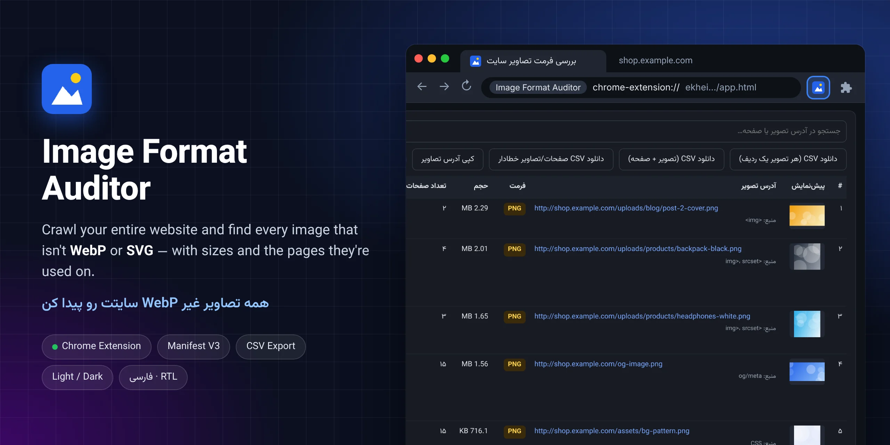
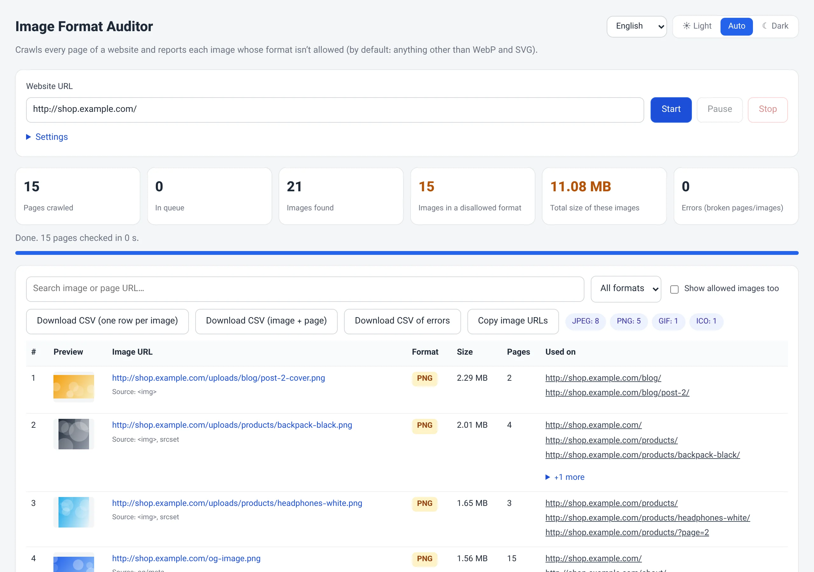
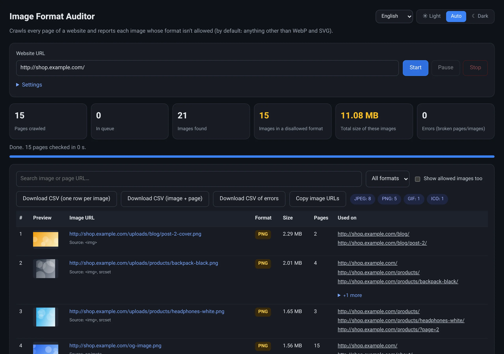
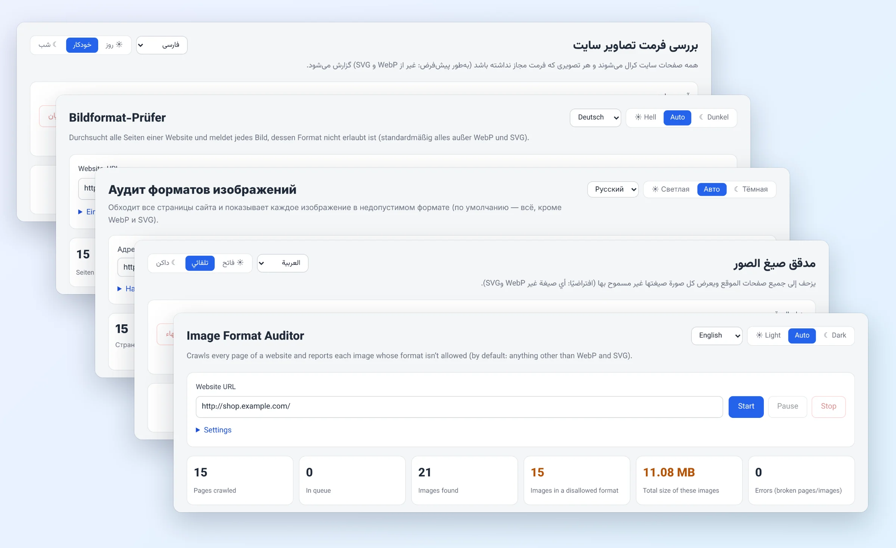
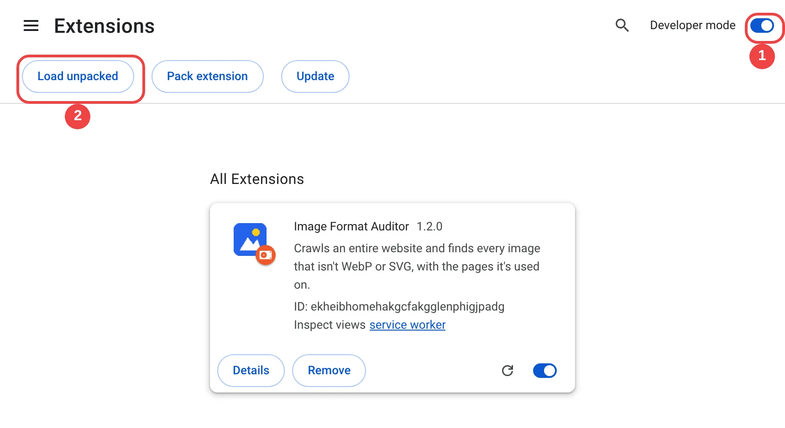

<p align="center">
  
</p>

<p align="center">
  <a href="https://github.com/arb195/mage-format-auditor/releases/latest"></a>
  
  
  
  <a href="LICENSE"></a>
</p>

---

**Image Format Auditor** is a Chrome extension that crawls an entire website and lists every image that isn't **WebP** or **SVG**. For each image it shows the real format, the file size and every page it's used on, so you know exactly what to convert first.

## Features

- **Full-site crawl:** follows internal links and reads `robots.txt` and `sitemap.xml` (including sitemap indexes).
- **Finds images everywhere:**
  - ``, `srcset`, `<picture>` and lazy-load attributes (`data-src`, `data-lazy-src`, …)
  - CSS backgrounds in external stylesheets (including `@import`), `<style>` tags and inline `style`
  - `og:image`, `twitter:image`, favicons, video posters and links that point straight to images
- **Real format detection:** checks the `Content-Type` the server actually sends, not just the file extension. A `.jpg` that your CDN serves as WebP isn't reported, and extension-less URLs such as `/_next/image?...` or `/cdn/img?id=12` are still detected.
- **Prioritise by impact:** sort by file size or by how many pages use the image. Total weight of the flagged images is shown up front.
- **Smart notes:** marks JPG/PNG files that are only the fallback of a `<picture>` that already has a WebP/AVIF source.
- **Broken items:** pages and images that return 404 or other errors are listed separately.
- **CSV export** (UTF-8 with BOM, opens correctly in Excel):
  - one row per image
  - one row per page–image pair
  - errors
- **Configurable:** choose which formats are allowed (WebP, SVG, AVIF, GIF, ICO), the page limit, concurrency, request delay, subdomains and URL patterns to exclude.
- **5 languages:** English, Arabic, Russian, German and Persian, with full right-to-left layout for Arabic and Persian. The language is picked from your browser automatically and can be changed at any time.
- **Light / dark / auto theme**, with the Vazirmatn font bundled (works offline).
- **Private by design:** no servers, no analytics, no dependencies. Everything runs in your own browser.

## Screenshots

| Light | Dark |
|:---:|:---:|
|  |  |

## Languages

| Language | Code | Direction |
|---|---|---|
| English | `en` | LTR |
| Arabic | `ar` | RTL |
| Russian | `ru` | LTR |
| German | `de` | LTR |
| Persian | `fa` | RTL |

<p align="center"></p>

## Installation

1. Download the latest `image-format-auditor.zip` from [**Releases**](https://github.com/arb195/mage-format-auditor/releases/latest) and unzip it, or clone the repo:
   ```bash
   git clone https://github.com/arb195/mage-format-auditor.git
   ```
2. Open `chrome://extensions` (Edge: `edge://extensions`, Brave: `brave://extensions`).
3. Turn on **Developer mode** ①.
4. Click **Load unpacked** ② and select the extension folder (the one that contains `manifest.json`).
5. Pin the extension from the puzzle-piece menu so it stays in your toolbar.

<p align="center"></p>

## Usage

1. Open any page of the site you want to audit and click the extension icon. The tool opens in a new tab with the site's address already filled in.
2. Press **Start**. Progress, page count and results update live, and you can pause or stop at any time.
3. Filter by format, search by URL, sort by size or page count, then export to CSV.
4. Use the language menu and the Light / Auto / Dark switch in the top corner to change the interface.

> **Tip:** keep the tool's tab open until the crawl finishes. Results live in memory and are lost when the tab is closed.

## Settings

| Setting | Default | Notes |
|---|---|---|
| Max pages | 5000 | Upper limit on pages crawled |
| Concurrent requests | 4 | Lower it (1–2) for sites behind a WAF or rate limit |
| Delay between requests | 0 ms | Be gentle with small servers |
| Allowed formats | WebP, SVG | AVIF, GIF and ICO can be allowed too |
| Read sitemap.xml | on | Finds pages that aren't linked anywhere |
| Verify real format | on | One `HEAD` request per image (falls back to a 1-byte ranged `GET`) |
| Include subdomains | off | e.g. `blog.example.com` when auditing `example.com` |
| Parse CSS files | on | Background images in stylesheets |
| Excluded URL patterns | `/wp-admin`, `logout`, `/cart`, … | One pattern per line |

## Good to know

- Requests are sent with your browser's cookies, so sites protected by Cloudflare or ArvanCloud usually work if you have opened them once in the same browser.
- Images that are injected only by JavaScript after the page loads aren't in the initial HTML and may not be detected.
- The crawler only follows pages on the same domain. Images hosted on CDNs or other domains are still reported.

## Project structure

```
├── manifest.json     # Manifest V3 config
├── background.js     # Opens the tool in a new tab when the icon is clicked
├── app.html          # UI
├── app.css           # Styles + light/dark theme variables
├── app.js            # Crawler, image extraction, format detection, CSV export
├── i18n.js           # UI translations and language switcher
├── theme.js          # Theme switcher (auto / light / dark)
├── _locales/         # Extension name/description per language (chrome.i18n)
├── fonts/            # Vazirmatn (SIL OFL 1.1)
├── icons/
└── docs/             # README images
```

## Contributing

Issues and pull requests are welcome. Please open an issue first to discuss larger changes.

**Adding a language:**

1. In `i18n.js`, add the language to `LANGS` (name, text direction, number locale).
2. Copy the `en` block in `STRINGS` and translate every key.
3. Add `_locales/<code>/messages.json` for the extension name and description shown in Chrome.

## License

[MIT](LICENSE). The bundled [Vazirmatn](https://github.com/rastikerdar/vazirmatn) font is licensed under the [SIL Open Font License 1.1](fonts/Vazirmatn-OFL.txt).

